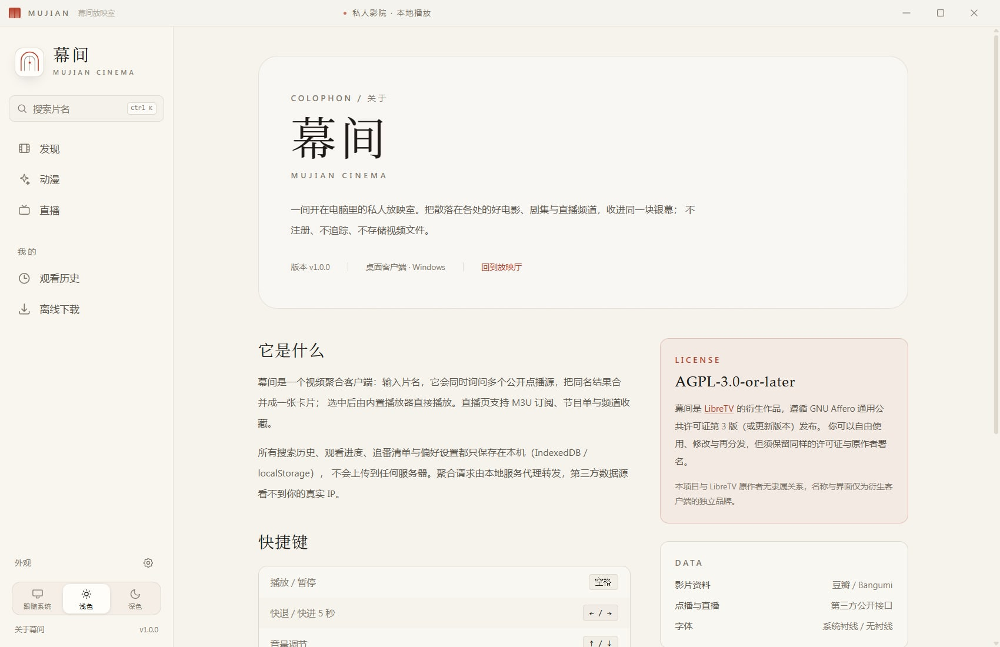
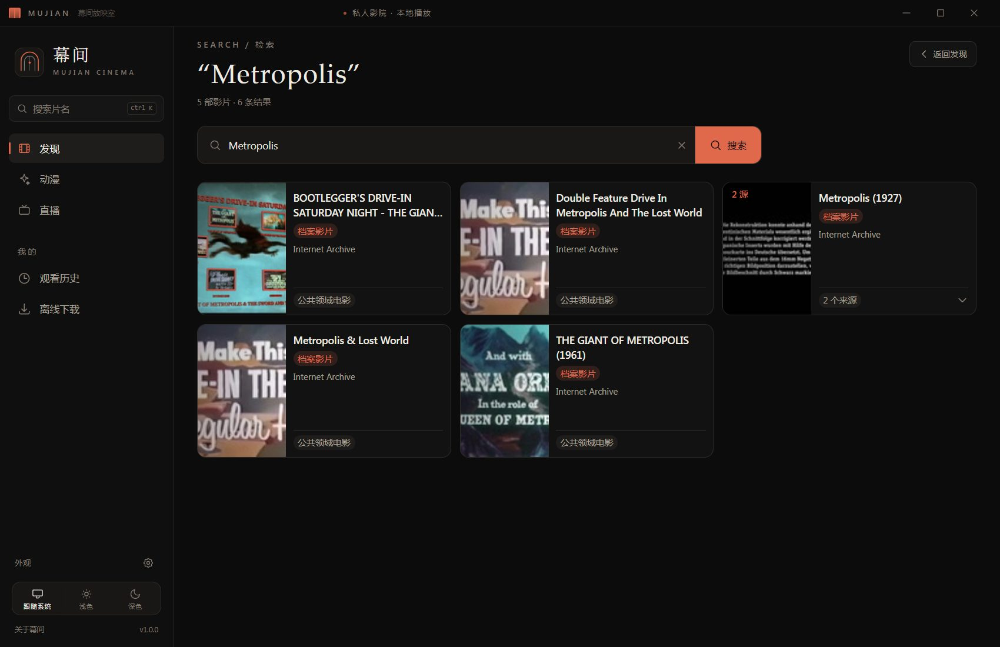

# 幕间 MUJIAN

> 一间只为放映而存在的私人影院。

幕间是一个 Windows 桌面视频聚合客户端：把散落在不同公开接口里的电影、剧集、直播和番剧，收进同一块银幕。它不提供片源，只负责把搜索、整理和播放做得安静一点。

基于 [LibreTV](https://github.com/LibreSpark/LibreTV) 的前端衍生，重做了界面与桌面运行时，并以 **AGPL-3.0-or-later** 开源。


## 特性

- **开箱即用的公共片源**：内置 Internet Archive 八组公共档案片源（公共领域电影 / 经典动画 / 默片时代 / 经典电视 / 普雷林格档案 / 复古动画 / 短片集 / 教育影像），安装后无需配置即可搜索、播放。
- **跨源聚合搜索**：同时询问多个公开点播接口，同名结果合并为一张卡片；失败源、停用源、未订阅源分别提示。
- **批量导入自己的源**：在源管理中粘贴多行「名称,地址」或 JSON，一次最多 300 个，只保存在本机，不会上传。
- **内置播放器**：HLS / MP4 播放，记忆播放进度，支持选集、倍速、全屏和画中画。
- **动漫专区**：Bangumi 每日放送表、豆瓣动画片单、本地追番清单；Bangumi 不可用时自动切换到豆瓣日本动画，不留下空白页。
- **直播**：M3U 订阅、频道分组、收藏、EPG 与频道探测。
- **本地优先**：搜索历史、观看进度、追番、偏好设置只保存在本机（IndexedDB / localStorage），不登录、不上传。
- **桌面体验**：无边框窗口、自定义标题栏、托盘、单实例、窗口位置记忆、关闭到托盘。
- **深色模式**：跟随系统，也可手动锁定浅色 / 深色；首屏内联脚本避免闪烁。
- **安静的视觉**：纸白、墨黑与朱砂红，衬线标题，横向片单，老电影院的颗粒感。

| 动漫 | 关于 |
| --- | --- |
|  |  |



## 下载

从 [Releases](../../releases) 下载 Windows x64 免安装版：

- `Mujian-1.0.0-win64.zip`（推荐）：解压到普通目录后运行 `Mujian.exe`，启动约 5–10 秒。
- `Mujian-1.0.0-portable.exe`：单文件便携版，首次启动需要自解压约 150 MB，可能需要等待 30–60 秒，请耐心等到窗口出现。

> 不要把程序放在 `D:\dsh\日常` 这类带低完整性 ACL 的受控目录里；Electron 会无法创建子进程。请复制到桌面、`C:\Users\Public` 或其他普通目录再运行。

SHA256（portable）：`F3F193B4328EC7E4D5130198410E1AC2F8C0C0D14BF9671D022F1DADA28971D7`
SHA256（win64 zip）：`BCA12AFC9479AD09196E087C784535E95473D2FA6705E9EDF71EAF4DB96E8AD3`

应用未做代码签名，Windows SmartScreen 可能提示“未知发布者”；确认文件来自本仓库 Releases 后选择“仍要运行”。

首次启动会在 `%APPDATA%\幕间` 生成本机配置、日志和随机访问密码。应用只监听 `127.0.0.1`，并自动完成本机会话登录，不需要手动输入密码。

幕间内置八组 Internet Archive 公共档案片源（公共领域电影 / 经典动画 / 默片时代 / 经典电视 / 普雷林格档案 / 复古动画 / 短片集 / 教育影像），可以在「设置 → 源管理」中查看；若要替换，可通过 `DEFAULT_SOURCES` 环境变量配置自己的预置源。除此之外不内置任何商业采集站；需要中文片源时，请自行添加 Apple CMS 接口或导入一份源列表订阅。

## 开发

要求：Node.js 20+、npm 10+、Windows 10/11。

```powershell
npm install

# 本地 Web 预览（默认 http://localhost:8090）
$env:PASSWORD = "mujian-dev"
npm run dev
```

> 上游鉴权要求设置 `PASSWORD`。桌面壳会为每个用户生成随机密码并自动登录；直接跑 `next dev` 时需要自己指定一个。

构建 Windows 桌面版：

```powershell
# 1. 生成 Next.js standalone
npm run build:desktop

# 2. 生成免安装版
npm run dist
```

产物在 `release/`。`build:desktop` 会把 `.next/static` 与 `public` 复制进 standalone；`afterPack` 钩子会补齐 standalone 的 `node_modules`（electron-builder 默认会跳过 extraResources 里的依赖目录）。

如果网络无法访问 GitHub，electron-builder 下载 7zip 会失败。可提前把工具放在本地，并设置：

```powershell
$env:ELECTRON_BUILDER_7ZIP_PATH = "D:\path\to\7za.exe"
```

## 结构

```text
mujian/
├─ src/                 Next.js 15 + React 19 前端
│  ├─ app/              发现 / 动漫 / 直播 / 播放 / 关于
│  ├─ components/       应用壳、片单、卡片、播放器、设置抽屉
│  └─ lib/              源聚合、豆瓣、Bangumi、播放地址、Dexie
├─ desktop/             Electron 主进程与 preload
├─ scripts/             standalone 构建、afterPack、截图
├─ build/               应用图标与打包资源
└─ electron-builder.yml Windows 打包配置
```

桌面端不重写上游业务：

1. Electron 用自带的 Node 启动 `.next/standalone/server.js`，只绑定 `127.0.0.1`。
2. 主进程生成随机密码，按上游 `lib/auth` 的算法预写 `ltv_session` Cookie。
3. 无边框窗口加载本地地址，`preload` 只向同源页面暴露窗口控制接口。
4. 外链交给系统浏览器，`webview` 被禁用，渲染进程开启 `contextIsolation` 与 `sandbox`。

## 数据与隐私

- 不收集遥测，不需要账号。
- 搜索词、观看历史、播放进度、追番与设置仅存本机。
- 聚合请求由本地服务代发；第三方接口仍可能看到请求内容。
- 日志位于 `%APPDATA%\幕间\logs`，可在托盘菜单打开。
- 卸载应用不会自动删除 `%APPDATA%\幕间`；需要彻底清理时手动删除该目录。

## 免责声明

幕间**不提供、不存储、不分发任何视频文件**。内置片源仅指向 Internet Archive 的公共档案；其余内容来自用户自行配置的第三方接口，其可用性、合法性与安全性由相应提供方负责。

请仅将本项目用于学习、研究与播放你有权访问的内容。使用者应自行遵守所在地法律法规与第三方服务条款。因使用本项目产生的任何后果，由使用者自行承担。

本项目与 LibreTV 原作者无隶属关系；名称、界面与桌面端实现为衍生项目的独立品牌。

## 许可

[GNU Affero General Public License v3.0 or later](LICENSE)。

本项目是 LibreTV 的衍生作品，保留其版权声明与许可；修改说明见 [NOTICE](NOTICE)。如果你分发修改后的版本，请同样以 AGPL-3.0-or-later 开源，并提供对应源代码。

## 致谢

- [LibreTV](https://github.com/LibreSpark/LibreTV)：上游前端与聚合逻辑
- [Bangumi 番组计划](https://bgm.tv/)：放送表数据
- [豆瓣](https://www.douban.com/)：影片资料与海报
- [ArtPlayer](https://artplayer.org/)、[Next.js](https://nextjs.org/)、[Electron](https://www.electronjs.org/)、[Tailwind CSS](https://tailwindcss.com/)

如果幕间让你的某个晚上安静了一点，欢迎点亮一颗 Star。
